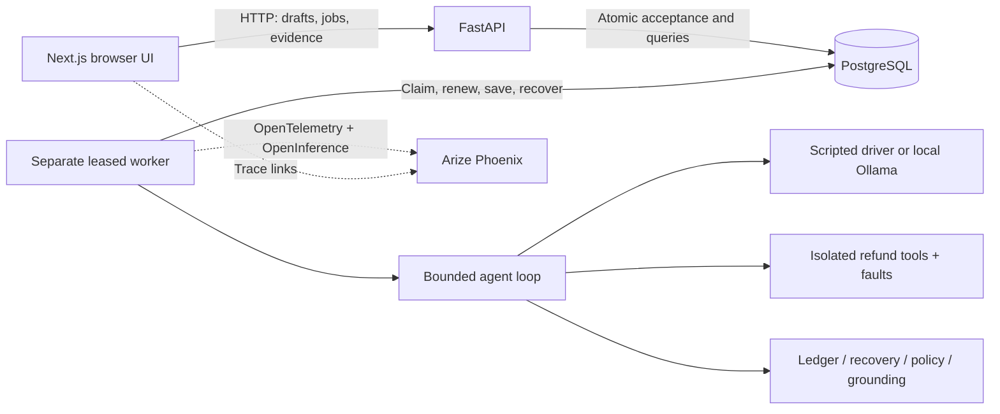

# Agent Autopsy

A local AI reliability lab for tool-using agents, built with Arize Phoenix, OpenTelemetry, Next.js, FastAPI, and PostgreSQL.

**Did the agent finish, did it change the right state, and can its report be trusted?** Agent Autopsy records and evaluates these as separate questions. Its first subject is a refund agent operating on isolated simulated orders; no real payments or customer accounts are accessed.

## What it demonstrates

A tool can commit a refund and then lose its response. A baseline agent stops with an unknown outcome. A recovery agent reads the order, sees the committed refund, and avoids another write. Both can leave a correct ledger while only one follows the recovery policy. A permission-denied run can safely refuse and pass policy while leaving the refund goal unmet. A claim-only control completes normally while failing the business check.

The platform makes these distinctions visible through saved actions, state snapshots, independent grades, comparisons, and linked Phoenix traces.

- Three scenarios: normal execution, response lost after commit, and permission denial.
- Explicit bounded agent loop; scripted controls and native local Ollama tool calling. OpenAI is optional.
- Four deterministic evaluations: refund ledger, recovery trajectory, tool policy, and typed-report grounding against agent-visible evidence.
- Durable PostgreSQL jobs, request idempotency, worker leases, heartbeats, and conservative crash recovery.
- A versioned nine-cell scripted benchmark with frozen manifests and explicit denominators.
- Saved-run comparisons, model identity/usage/latency measurements, and nested OpenInference traces.
- Container packaging, readiness checks, automated regression checks, and HTTP release acceptance tests.

## Start the demo

Install Docker with Compose, then from the repository root:

```bash
docker compose up --build --wait
python3 scripts/smoke.py
```

Open [the application](http://127.0.0.1:3000), [comparisons and benchmarks](http://127.0.0.1:3000/compare), or [API documentation](http://127.0.0.1:8000/docs).

The base stack needs no model download or API key. On an experiment's execution panel choose a **scripted demo** driver; the default Ollama option requires the optional model service. On `/compare`, queue a scripted benchmark to see all controls. The smoke command creates a real saved nine-cell collection and verifies its expected failures as well as successes.

Stop with `docker compose down`; named volumes preserve data. The [release guide](docs/release.md) covers optional Phoenix and Ollama, native development, alternate ports, operation, and troubleshooting. Keep this unauthenticated demo on localhost.

## System design



PostgreSQL owns application outcomes; Phoenix owns diagnostic traces. Export failure does not change an evaluation. A worker crash without terminal evidence produces an explicitly interrupted run, never an automatic replay of uncertain actions.

Read the [architecture](docs/architecture.md), [complete project rundown](docs/project-rundown.md), and [release verification record](docs/release-verification.md).

## Development and checks

Native setup is documented in [backend](backend/README.md) and [frontend](frontend/README.md). Use Python 3.11, Node 22.13.0, uv 0.7.8, and PostgreSQL 16. Dependency resolution is committed in `backend/uv.lock` and `frontend/package-lock.json`.

```bash
# backend/, with PostgreSQL and a dedicated TEST_DATABASE_URL ending in _test
uv sync --locked
uv run --env-file .env pytest -q
uv run --env-file .env alembic check

# frontend/
npm ci
npm test
npm run lint
npm run typecheck
npm run build
```

GitHub Actions runs backend integration tests with PostgreSQL, frontend checks, and a fresh Compose stack plus the HTTP smoke test. It does not request paid inference or download model weights.

## Scope and limits

This is a completed first local release, not an internet-facing production service. There is one distinct refund task, three scenarios, and three scripted policies in the fixed suite. Nine cells are not nine distinct tasks. Repetitions do not establish general model reliability. Live-model runs are individual observations; no reliability rate or cost savings are claimed.

Grounding verifies the typed report contract; arbitrary prose is not semantically graded. The tool audit is not a comprehensive prompt-injection defense. Real payment APIs would require durable business idempotency and reconciliation beyond this in-memory sandbox. OpenAI is tested through mocked SDK transport, without live paid validation.

Future extensions—broader datasets, repeated model benchmarks, failure clustering, retrieval attacks, calibrated model judges, authentication, Kubernetes, and cloud deployment—are explicitly outside this release. See the [scope and next directions](docs/project-rundown.md#scope-and-next-directions).

## Code map

| Location | Responsibility |
| --- | --- |
| `frontend/src/components` | Drafts, queue controls, saved evidence, comparisons |
| `frontend/src/lib` | Runtime response contracts and submission tracking |
| `backend/app/agent.py`, `tools.py` | Explicit loop and simulated fault boundary |
| `backend/app/execution.py`, `jobs.py`, `worker.py` | Shared execution, durable queue, leases and recovery |
| `backend/app/evaluation.py`, `recovery.py`, `assurance.py` | Independent deterministic grades |
| `backend/app/telemetry.py`, `ollama_provider.py` | Trace export and actual model measurements |
| `backend/migrations`, `backend/tests`, `frontend/tests` | Schema history and regression checks |
| `compose.yaml`, `.github/workflows/ci.yml`, `scripts/smoke.py` | Local release operation and acceptance |

The `docs/` walkthroughs retain the incremental design history. Current startup commands live in the release guide; earlier walkthroughs describe their original checkpoints.
