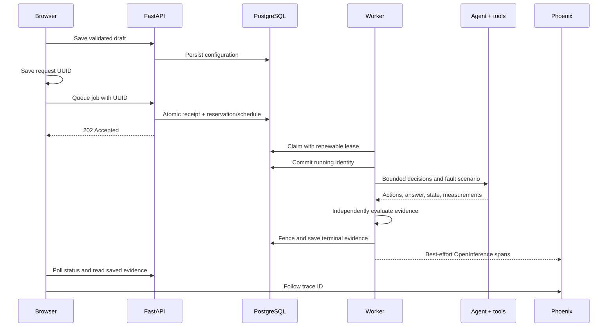

# Architecture of the first local release

Agent Autopsy investigates the gap between an agent's response and what its tools actually did. The current unit of experimentation is a simulated $49 refund with exactly one scenario. Controlled evidence supports debugging; it does not establish reliability across arbitrary tasks.

## Request flow

## Component and data ownership

Next.js owns forms, submission tracking, polling, and presentation. Runtime guards validate network JSON in addition to TypeScript's compile-time checks. FastAPI owns input validation, admission, queries, and comparison rules. It initializes no provider during enqueue. The separate worker invokes the same explicit engine used by inline diagnostic CLIs.

PostgreSQL stores experiments, runs, benchmarks, scheduled items, and jobs. Runs retain scenario, actual fault exercise, answer, actions, state snapshots, versioned evaluations, model measurements, and optional trace ID. Benchmarks freeze schedules and source/configuration manifests. Jobs store submission identity, reserved result identity, ownership, and processing status.

Phoenix owns diagnostic spans in a separate local store. Trace IDs link stores without creating a distributed transaction. A failed export can lose diagnostics but cannot change PostgreSQL outcomes.

## Independent outcomes

| Dimension | Evidence |
| --- | --- |
| Execution completion | Whether the bounded loop ended normally |
| Refund correctness | Fixed task expectation against actual sandbox ledger |
| Recovery trajectory | Verification/refusal behavior under the selected fault policy |
| Tool policy | Supported names, validated arguments, audited unsafe attempts |
| Typed-report grounding | Structured facts supported by agent-visible tool responses |
| Job processing | Whether a durable terminal run/collection was produced |

The claim-only script completes but leaves an incorrect ledger. A safe permission refusal passes recovery while failing the refund goal. A timeout baseline can leave a correct ledger while failing execution/recovery. Grounding cannot treat hidden post-timeout state as something the agent observed. Unsupported prose stays unavailable; missing evidence suppresses comparisons rather than inventing deltas.

## Concurrency and recovery

One PostgreSQL transaction accepts the receipt and reserves its target; a benchmark also saves all cells. This avoids a database/broker dual write. Admission is bounded to 100 active jobs. Workers claim with `FOR UPDATE SKIP LOCKED`; unique tokens and database time fence result publication. Heartbeats use a separate connection while model I/O occurs outside database transactions.

Recovery retains terminal runs, continues untouched cells, and marks unknown started executions interrupted without automatic replay. Three worker claims bound recovery; abandoned cells stay in the denominator. This is not exactly-once execution of real external effects. Real payments would need business idempotency and reconciliation.

Workers capture startup source/model-setting fingerprints. Changed code requires restart; incompatible queued jobs fail before unstarted execution. Actual model identity/digest is measured at runtime because mutable aliases cannot freeze weights. See [worker details](durable-workers.md).

## Deployment and tradeoffs

Compose runs API, worker, migrations, PostgreSQL, and a standalone Next.js server; Phoenix and container Ollama are optional. Readiness checks database/schema compatibility, not optional provider availability. A live worker process does not prove processing progress; the HTTP smoke check exercises that path.

PostgreSQL meets the present queue needs, so Redis would add another operational dependency. Kubernetes would not solve a measured problem for this single-host local release. At larger scale, measure queue delay, model saturation, database contention, and exporter loss first. Model concurrency needs capacity limits; real external tools need business idempotency; public access needs authentication, quotas, retention, and authorization. General reliability estimates require more distinct tasks and repeated observations.

See [operation commands](release.md) and the [project rundown](project-rundown.md).
