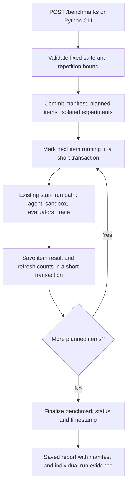

# Reproducible benchmark runner

Current HTTP execution uses [durable jobs and workers](durable-workers.md). This earlier checkpoint documents the shared inline engine; synchronous HTTP routes now require an explicit debugging opt-in.

This is the first of the six release milestones. It turns individual refund runs
into a saved, repeatable comparison. It deliberately starts with scripted drivers;
live model validation is the next milestone.

## The suite

`refund-resilience-v1` contains **one distinct business task**: refund the full
4,900 USD cents for `order-123`. Three scenario cases exercise that task:

- `full-refund-normal`: ordinary successful tools.
- `full-refund-lost-response`: refund mutates state, then its response is lost.
- `full-refund-permission-denied`: every valid refund attempt is rejected before mutation.

Each case runs against `demo`, `demo_reconcile`, and `demo_claim_only`, in a fixed
order. One repetition schedules nine executions. Two or three repetitions schedule
18 or 27 executions. These are repeated cells, not additional independent tasks.
Repeated deterministic scripts do not establish statistical model reliability.

The suite definition is server-owned. Requests can choose the suite version and
1–3 repetitions. They cannot replace cases, alter expected results, inject a
passing summary, or enable paid OpenAI benchmark execution.

## Request and execution flow



The HTTP endpoint is synchronous for this small bounded suite. There is no queue
or background scheduler yet. No database transaction wraps the entire suite or
the agent's decision loop. A separate connection can read the committed schedule
and progress while execution is still running.

The single-run orchestrator now captures scalar trace metadata before its claim
transaction closes. This prevents SQLAlchemy's normal expire-on-commit behavior
from reopening a transaction during execution. Both the web application's
non-expiring sessions and default expiring sessions work.

Every scheduled item gets a separate experiment and fresh in-memory order state.
The existing single-run path still performs the atomic experiment claim,
six-turn agent loop, deterministic evaluations, and optional Phoenix export.
Benchmark-created experiments also appear in the current saved-experiment list.
A dedicated benchmark comparison interface is a later milestone.

## Persistence

Migration `cf13a9502ab7` adds:

- `benchmarks`: suite version, manifest snapshot, summary snapshot, orchestration
  status, and actual start/finish timestamps.
- `benchmark_items`: ordered schedule, case key, driver, repetition, experiment
  reference, optional execution reference, collection status, and safe error.

Unique constraints prevent duplicate positions and duplicate cells within a
benchmark. Each item has a stable UUID that is also used as its intended
`agent_runs.id`. The nullable `run_id` is filled once an actual execution exists;
a database constraint requires it to match that stable identity. Each execution
can belong to only one benchmark item.

That identity matters when something throws **after** saving an execution. The
runner looks up the intended execution before declaring evidence lost. A terminal
saved result is retained with a warning, without running the agent again. A saved
but unfinished execution is linked for inspection and classified as an
infrastructure failure. Neither case triggers an automatic retry.

The migration refuses to drop benchmark tables when saved benchmark history
exists. An empty installation can still be downgraded and upgraded. Existing
experiment and run records are not reclassified or backfilled into benchmarks.

## What is captured for reproducibility

The persisted `benchmark-manifest-v1` includes:

- Full suite definition, fixed schedule, repetition count, and canonical SHA-256
  suite digest.
- Agent instructions and tool schemas with separate digests, turn limit, and
  evaluator versions.
- SHA-256 fingerprints of backend application Python files, `pyproject.toml`, and
  `uv.lock`, plus an aggregate source digest.
- Git revision and whether the relevant backend source/configuration paths have
  uncommitted changes. When Git is unavailable, these fields may be null; file
  fingerprints remain available.
- Python version, operating system family, machine architecture, selected installed
  package versions, and actual Alembic schema revision.
- An explicit null model and a statement that these are deterministic scripts.

It does not snapshot environment variables, credentials, hostnames, user paths,
or raw provider payloads. Capturing metadata does not freeze a Python environment
or preserve uncommitted source content: use a clean committed revision and the
lockfile to reproduce it. Keep a published suite version's definition fixed;
create a new version when cases change. The suite and source digests expose
accidental changes under the same human-readable version.

Stored reports use their saved manifest and summary. Reading an old report does
not silently rerun current evaluators or rebuild it from today's suite definition.

## How to read the summary

`benchmark-counts-v1` reports raw counts overall and by driver. It keeps the
denominators explicit instead of collapsing different outcomes into one score.

| Count | Meaning |
| --- | --- |
| `planned` | Number of cells in the saved schedule |
| `recorded` | Collected terminal agent results, including failed executions |
| `infrastructure_failed` | Cells without a collectable terminal execution |
| `pending` | Cells still pending or running |
| `execution_completed` / `execution_failed` | Agent loop outcomes among recorded results |
| `ledger_passed` / `ledger_failed` / `ledger_not_evaluable` | Refund-goal evaluation counts |
| `recovery_passed` / `recovery_failed` | Actual trajectory-policy grades |
| `recovery_not_evaluable` | Missing/incompatible grades or unexercised faults |
| `recovery_not_applicable` | Normal scenarios, which did not test fault recovery |
| `fault_selected` | Fault-scenario cells in the saved schedule |
| `fault_injected` | Recorded executions that actually exercised their selected fault |

Missing item rows cannot shrink the planned denominator; they count as
infrastructure failures. Unavailable evaluations cannot become passes. Normal
scenarios cannot inflate recovery passes. Claim-only runs do not receive fault
coverage credit simply because a fault was selected.

For example, a conservative refund-goal rate can be calculated as
`ledger_passed / planned`, with unavailable and infrastructure counts shown beside
it. Exercised-fault coverage is `fault_injected / fault_selected`, when the latter
is nonzero. A policy pass rate must state its chosen eligible denominator and
show unavailable/not-applicable counts; no single percentage is emitted here.

The deterministic nine-cell contract is checked by automated integration tests:

| Driver | Collected | Execution completed | Ledger passed | Policy passed | Faults exercised / selected |
| --- | --- | --- | --- | --- | --- |
| Baseline | 3 | 1 | 2 | 0 | 2 / 2 |
| Recovery | 3 | 3 | 2 | 2 | 2 / 2 |
| Claim-only | 3 | 3 | 0 | 0 | 0 / 2 |

These numbers describe this fixed scripted suite, not a measured model benchmark.
Baseline and recovery both achieve four correct ledgers between them; their
different policy results capture why ledger correctness alone is insufficient.

`Benchmark.status=completed` means the suite collected all terminal results.
Expected agent failures and failed evaluations do not turn collection into an
infrastructure failure. A benchmark with one missing terminal result is `failed`,
while retaining the other results and all nine planned cells.

## API and CLI

After applying migrations and starting the API, these routes are available:

```text
GET  /benchmark-suites
POST /benchmarks                  {"suite_version":"refund-resilience-v1","repetitions":1}
GET  /benchmarks?limit=20&offset=0  summary records, newest first
GET  /benchmarks/{id}              saved manifest, summary, items, and nested run evidence
```

POST returns 201 for a saved report, including one whose collection status is
`failed`; inspect the body. Invalid configuration returns 422. Missing UUIDs return
404; malformed UUIDs return 422. Listing is bounded to 100 records per request.

The CLI uses the same service and PostgreSQL, without needing an HTTP server:

```bash
cd backend
uv run --env-file .env alembic upgrade head
uv run --env-file .env python -m app.benchmark --repetitions 1
```

It prints the benchmark ID, collection status, and summary as JSON. A completed
collection exits 0; an infrastructure-failed collection exits 1. Failed agent or
policy grades alone do not fail the CLI. It is not a regression gate yet. The
usual tracing environment setting enables real per-run Phoenix spans and trace
IDs. Benchmark item records link those executions; this step does not create
Phoenix dataset experiments or annotation scores.

Starting the command or POST again creates a new benchmark. There is no request
idempotency key, resume operation, worker lease, automatic recovery, or cross-suite
concurrency cap. A process interruption may leave a header or item marked running;
earlier committed results remain available. Database unavailability can prevent
final progress updates. These are explicit inputs to the background-worker
milestone, not guarantees this synchronous runner provides.

## Verification and next steps

Automated tests exercise the full matrix with PostgreSQL, repetition isolation,
configuration rejection, manifest fingerprints, persisted history, explicit
denominators, evaluator and infrastructure failures, late exceptions, partial
execution evidence, trace correlation, database constraints, and downgrade
protection. A two-connection test confirms committed progress remains readable
while an agent decision is blocked.

The application walkthrough is deferred at the user's request. This milestone
adds the backend runner and CLI; it does not add a new dashboard or perform live
model requests. Next: validate a real model and capture actual request metadata
before expanding version-comparison views. A diverse dataset with additional
orders, amounts, and tasks requires parameterizing the sandbox and expectations;
repeating this one task is not a substitute.
