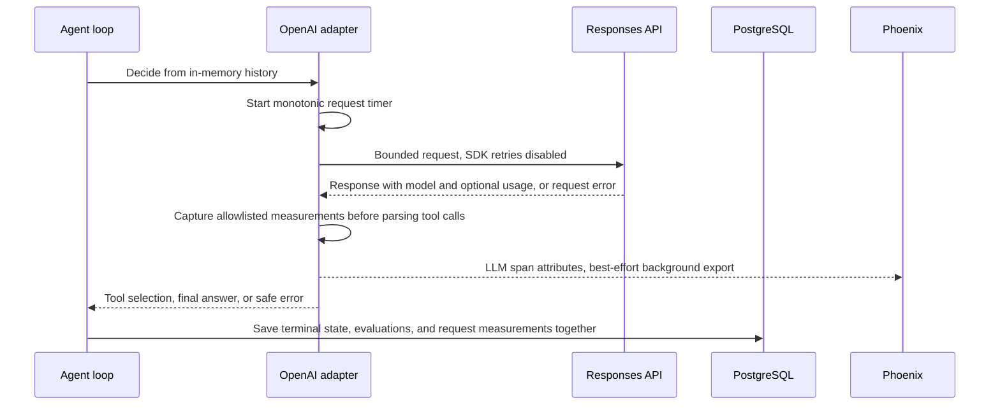

# OpenAI request measurements and validation (earlier checkpoint)

The subsequent [local Ollama checkpoint](ollama-local.md) adds key-free native execution and actual local validation. This document describes the optional OpenAI path.

This checkpoint implements the measurement and validation tooling for release
milestone two. **A successful real OpenAI validation has not yet been recorded.**
The backend API key and model were absent when implementation began. Automated
tests use the installed OpenAI SDK with mocked HTTP, not paid provider calls.

## What changes



Each model-backed run now has nullable `model_telemetry`, typed as
`openai-responses-v1`. It includes requested model, configuration fingerprints,
individual requests, aggregate known usage, usage coverage, and measured total
request duration. It is returned by run history and nested benchmark-run response
contracts. A new frontend metrics display belongs to the comparison-view milestone.

The existing `model_name` field continues to identify the configured model.
Individual measurements separately preserve the provider-reported model string;
an alias and a returned snapshot need not have the same name. Neither is proof of
model quality or repeatability by itself.

## Request measurements

For every attempted request, including one that throws, the adapter records:

- Sequence number and configured model.
- Provider-reported model when a response supplies a valid string.
- Client-observed duration in milliseconds, measured with a monotonic clock.
- Whether a response arrived or the request threw, plus normalized response status.
- A safe error category: timeout, rate limit, authentication, permission,
  connection, other API error, or unexpected error. Raw error bodies are omitted.
- Usage status: `reported`, `unavailable`, or `invalid`.
- Valid input, output, and total token counts, with optional cached-input,
  cache-write-input, and reasoning-output breakdowns.

The adapter captures this **before** checking response completion or parsing tool
arguments. An incomplete response can still have measured usage even though its
tool calls are refused. A later provider timeout does not erase earlier tool
effects or earlier measurements.

The [official Responses API reference](https://developers.openai.com/api/reference/python/resources/responses/methods/create)
documents usage and token breakdown fields. The local adapter validates strict
nonnegative integers, checks input plus output against the total, and rejects
breakdowns larger than their parent counts. Missing breakdown fields remain null.
Unknown extra usage fields are not copied into application records.

Cached input is part of input tokens. Reasoning output is part of output tokens.
Neither is added again to the total. Usage from repeated history on successive
requests is counted per request, as reported; the application does not deduplicate
it based on matching text.

## Aggregation and uncertainty

`known_usage` sums only requests with compatible reported usage. It is null when
none are available, including a run whose first request times out. A genuine
provider-reported zero remains a measured zero.

For example, three attempts with valid totals of 120 and 120 followed by a timeout
produce a known subtotal of 240 tokens, two requests with reported usage, and
`usage_complete=false`. This is not a claim that the entire run consumed exactly
240 tokens. A failed request can have an unknown provider-side outcome.

`usage_complete` concerns the availability of valid core input/output/total counts
for every attempt. Optional cache/reasoning details can remain unknown even when
those core counts are complete. An optional aggregate breakdown is null when any
included reported request lacks that breakdown. Zero attempts do not establish
complete usage.

`total_request_duration_ms` sums client-observed request durations, including failed
attempts. It includes network and SDK overhead. It is neither provider-only
processing time nor the full agent-run duration, which also includes tools,
evaluation, and persistence.

No dollar cost is calculated. Token counts are provider measurements; converting
them into a cost estimate requires versioned pricing, model and service-tier
information, and treatment of caching. Even a future estimate would not be an
invoice. This checkpoint does not invent a zero cost for unknown usage.

## Configuration and boundaries

Each OpenAI driver snapshots the fixed instructions and tool schemas for its run.
Telemetry stores their SHA-256 fingerprints and the request settings: 1,024 maximum
output tokens, ten-second SDK request timeout, zero SDK retries, disabled response
storage, no parallel tool calls, and the six-turn agent limit. Fingerprints detect
configuration changes; they do not preserve old source code. Use the corresponding
committed code to reproduce the configuration.

Timeouts and output limits bound this small validation path but do not define a
dollar spending cap. Output limits can also cause a reasoning response to finish
incomplete. This remains an outcome to inspect, not a reason to silently retry or
raise the limit. There is no streaming, token estimation, automatic fallback
model, response-body logging, or automatic provider retry.

Demo runs remain unmeasured and emit no LLM spans. The scripted benchmark still
rejects requests to switch it to OpenAI. Live validation runs a single saved
experiment through the existing agent path, rather than converting the nine-cell
scripted benchmark into paid work.

## Phoenix and persistence

LLM spans use OpenInference prompt/completion/total token attributes and available
cache-read/cache-write/reasoning breakdown attributes. `llm.model_name` uses the
reported model when present, otherwise the configured target. Separate attributes
retain the requested model, request duration, usage availability, response status,
and safe error category.

Token totals are not copied onto the root agent span, avoiding double-counting
when summing LLM spans. Root attributes instead report request count and usage
coverage. Phoenix export remains independent of durable PostgreSQL results.

Migration `53242250fbfc` adds nullable JSONB with a constraint allowing populated
measurements only on OpenAI-mode runs and requiring an object. Existing historical
runs retain null, rather than receiving invented measurements. Downgrade refuses
to erase recorded model telemetry.

The final short run transaction saves measurements with execution evidence and
both evaluations. A telemetry collection error logs only its exception class and
leaves telemetry null while retaining the execution. Null means unavailable or
not collected; it never establishes zero model requests or zero usage.

No credentials, authorization headers, raw provider-error bodies, complete request
histories, or encrypted reasoning content enter the telemetry object. Existing
application evidence still intentionally includes the final answer and simulated
business tool actions.

## Configure and validate when ready

Keep the key in the ignored backend environment file, not in chat or frontend
variables. Start from the example if a local file does not already exist:

```bash
cd backend
cp -n .env.example .env
# Edit .env locally to set OPENAI_API_KEY and OPENAI_MODEL.
uv run --env-file .env python -m app.validate_model --provider openai
```

Invocation with `--provider openai` and no `--execute` only checks whether key and model are nonempty. It does not
contact the provider or database and cannot confirm account access, billing, or
model availability. It prints booleans, not credentials. Missing configuration
exits 2, including when `--execute` was requested, before creating a record.

An explicit execution makes potentially billable requests for one scenario:

```bash
uv run --env-file .env python -m app.validate_model --provider openai --execute --scenario normal
```

The two fault scenarios can be validated separately later:

```bash
uv run --env-file .env python -m app.validate_model --provider openai --execute --scenario timeout_after_commit
uv run --env-file .env python -m app.validate_model --provider openai --execute --scenario permission_denied
```

Apply migrations first. Set tracing enabled and start Phoenix when an exported
trace is desired. CLI execution configures and shuts down its own tracing provider;
the web API server is not required. Repeating the command creates another run.

The JSON validation report includes run/experiment/trace IDs, measurements, and
independent checks for completed execution, completed provider responses, reported
model identity, usage coverage, scenario-appropriate ledger and recovery verdicts,
and actual exercise of a selected fault. Exit 0 means these checks passed; exit 1
means the recorded run failed at least one check. A denied refund must leave its
ledger goal unmet while passing recovery policy. A final-answer wording judge is
still absent, so passing validation does not establish truthful or useful prose.

## Verification status

Automated tests cover the installed SDK's HTTP request serialization, all three
sandbox scenarios, provider errors without retry, incomplete response usage,
unknown/invalid/zero usage, partial aggregates, exact monotonic timing, model-name
differences, safe persistence, root/LLM trace attributes, CLI preflight/execution
boundaries, historical nulls, and downgrade protection. The SDK transport is
mocked in those tests and PostgreSQL is real and isolated.

The application walkthrough remains deferred. Actual OpenAI provider access, live OpenAI model
behavior, observed OpenAI token usage, and an OpenAI-model Phoenix trace remain pending
until the backend credentials and chosen model are configured and the explicit
validation is run. This is the remaining activation step for milestone two.
