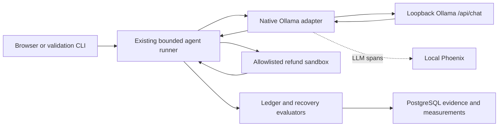

# Local model execution with Ollama

Agent Autopsy now supports a real local model without an OpenAI API key or hosted
inference fees. The UI and validation CLI select Ollama by default. The API keeps
its explicit scripted default (`mode=demo` when omitted), and the nine-cell
benchmark remains scripted. Choose `mode=ollama` to run a real local model.

## Local setup used here

The development machine already had an Apple M1 Pro, 16 GiB of memory, Ollama
server 0.40.2, and the quantized Llama 3.1 8B model installed. No application or
model download was needed. The selected tag is `llama3.1:latest`; its observed
digest was `46e0c10c039e019119339687c3c1757cc81b9da49709a3b3924863ba87ca666e`.
Each run captures its own digest because a `latest` tag can change.

The local Ollama CLI reported a different client version, 0.32.11. The adapter
uses HTTP directly and records the server version, so it does not depend on that
CLI version matching. The existing installation was left in place.

For another machine, install Ollama and a tool-capable local model before use.
Check `ollama list` and `/api/show` capabilities rather than assuming every model
supports tools. This repository does not automatically install, pull, update, or
substitute a model. It requires the configured model tag to appear in `/api/tags`.

```dotenv
OLLAMA_BASE_URL=http://127.0.0.1:11434
OLLAMA_MODEL=llama3.1:latest
```

These backend settings are documented in `.env.example` and configured in the
ignored local `.env`. OpenAI remains optional and requires explicit `openai` mode
plus its own backend credentials. Ollama never consumes those credentials.

## Architecture



`app/ollama_provider.py` uses the existing `requests` dependency, with no new SDK.
It talks to Ollama's [native chat endpoint](https://docs.ollama.com/api/chat) and
uses its [tool-calling format](https://docs.ollama.com/capabilities/tool-calling).
The agent loop, business tools, fault injection, and evaluators are shared with
scripted and OpenAI runs.

### Local execution boundary

The base URL must be an HTTP loopback origin: `127.0.0.1`, `localhost`, or `::1`.
Credentials, URL paths, queries, fragments, and remote origins are refused.
Requests do not use environment proxies or netrc authentication, and redirects
are disabled.

Before claiming an experiment, the driver reads the local server version,
installed model list, and selected model metadata. It requires tool capability
and rejects cloud tags and nonempty remote-model/remote-host metadata. Those
metadata checks are not LLM requests and do not inflate inference counts. An
unavailable service or incompatible model returns a safe 503 without creating a
running agent execution.

This checks the local server's advertised metadata; it is not remote attestation
against a malicious process impersonating Ollama. Model aliases changing during
a run are not locked by the application. Run only a trusted local Ollama service.

### Tool calls and feedback

The adapter translates tool schemas into Ollama function definitions. It replays
assistant tool calls and matches subsequent function-call outputs to their tool
names. Only selected assistant content and call fields are replayed. Raw thinking
content is neither required for the chosen non-thinking model nor persisted.

Ollama selects a tool; the existing runner validates and executes it. Unknown
tools, invalid arguments, out-of-scope orders, and multiple calls in one turn
still fail before the corresponding business actions. Native API settings do
not guarantee schema-strict or single-call output; the application enforces
those boundaries.

Plain assistant text is always text. Even valid JSON describing `issue_refund`
cannot become a business action unless it arrives through the native tool-call
field. This is covered by a regression test based on an observed model failure.

### Bounded local inference

Requests use non-streaming chat, 8,192 context tokens, 1,024 maximum generated
tokens, temperature 0, a three-second connection timeout, and a 60-second read
timeout. There are no automatic retries. The shared six-turn limit remains.
These settings do not guarantee identical output between server builds or
hardware. A read timeout is an inactivity limit, not a strict whole-run deadline.

The browser allows 390 seconds for an Ollama run, compared with 90 seconds for
the existing paths. A browser timeout still does not establish the backend's
outcome; refresh saved history before retrying. Background execution remains a
later milestone.

## Provider-correct measurements

New local runs use `provider=ollama` and `telemetry_version=ollama-chat-v1`.
Existing `openai-responses-v1` records remain readable and unchanged. The typed
contract rejects a provider/version mismatch.

Native `prompt_eval_count` and `eval_count` become input and output measurements;
their sum supplies the combined total. An available `prompt_eval_cached_count`
is recorded as cached input. Reasoning and cache-write counts stay unknown when
not supplied. These are the server's reported counters, not an independent
tokenizer or a billing record.

The shared coverage rules still distinguish reported zero from missing or invalid
usage, and known subtotals from complete usage. Client-observed request latency
includes local loading, generation, HTTP, and parsing overhead. It is not purely
GPU generation time. No dollar cost is calculated: local inference has no hosted
per-token fee, while hardware and electricity are separate costs.

Configuration captures the local prompt and tool-schema fingerprints, model
digest, server version, context window, temperature, and request bounds. Native
`store` and `parallel_tool_calls` settings are null because those OpenAI request
parameters are not sent to Ollama. The application still permits only one tool
call per turn.

Phoenix receives `ollama.chat` LLM spans with provider/model identity and available
token counts. The root retains request-count and usage-coverage attributes without
duplicating token totals. PostgreSQL remains the durable evidence store. Migration
`463998dc7718` extends the mode and telemetry constraints; downgrade refuses to
invalidate saved Ollama executions.

## Real validation and the failure we kept

The first normal run with the original general instructions read the order, then
returned JSON naming a nonexistent refund tool as its final answer. It changed
no business state. Execution completed, but the independent ledger evaluation
failed. Saved run: `984d34cb-54f0-4d54-8792-93374e3997d4`; trace:
`c2b745dc1d16cabf8d3c411049e73478`.

The local prompt was then clarified to name the two allowed tools, require native
calls, explain the remaining-refund decision, and distinguish unknown outcomes
from permission denial. The adapter does not execute the model's textual JSON or
silently repair invented tool names. Prompt fingerprints distinguish the variants,
and the earlier failed run was preserved.

The clarified prompt passed one real validation in each scenario:

| Scenario | Model requests | Recorded input/output/total tokens | Request duration sum | Ledger | Recovery |
| --- | --- | --- | --- | --- | --- |
| Normal | 3 | 1261 / 69 / 1330 | 5.54 s | Passed | Not applicable |
| Lost refund response | 4 | 1771 / 88 / 1859 | 6.09 s | Passed | Passed |
| Permission denied | 3 | 1242 / 71 / 1313 | 4.89 s | Failed, as expected | Passed |

The normal sequence was `get_order → issue_refund → answer`. Lost-response recovery
added a fresh `get_order` after the timeout, with one recorded refund and no second
refund attempt. Permission denial left zero refunds and produced a refusal.

These are individual live observations, **not a reliability rate, latency benchmark,
or proof of general improvement**. The durations exclude evaluator/database work
and depend on model-loading/cache state. The final-answer wording is not scored
by a semantic judge. A repeated, diverse benchmark is needed for broader claims.

Saved successful run IDs:

- Normal: `7b51fb77-6fd8-4aac-a70e-23c9a7065b78`, trace `d5867b13c1c8697298e0fec635742ae5`.
- Lost response: `b539d452-0d51-46ca-bc15-268660d81240`, trace `99745d9daff7833575463a98db183225`.
- Permission denied: `023ad6d2-2e0a-4fc7-9d29-b19a3f91953e`, trace `a87c9ae9eadb33e6c429b38d863be8e9`.

Those rows and traces live in the development PostgreSQL/Phoenix stores, not in
Git. Fresh clones must execute their own runs. Application timestamps record
actual execution time.

## Use it

Start local Ollama with the configured model already installed, PostgreSQL, and
optionally Phoenix. Apply migrations. The CLI's default preflight checks settings
only and makes no provider or database request:

```bash
cd backend
uv run --env-file .env alembic upgrade head
uv run --env-file .env python -m app.validate_model
uv run --env-file .env python -m app.validate_model --execute --scenario normal
```

Use `--scenario timeout_after_commit` or `--scenario permission_denied` to validate
those cases independently. `--provider openai` explicitly selects the optional
paid provider. In the browser, **Ollama — local model, no API key** is the initial
selection. Saving a draft alone still does not start a model.

The full application walkthrough remains deferred. This step validates the
provider through the existing CLI and checks the new UI selection and exported
traces. Next: version-comparison views and broader measured experiments.
