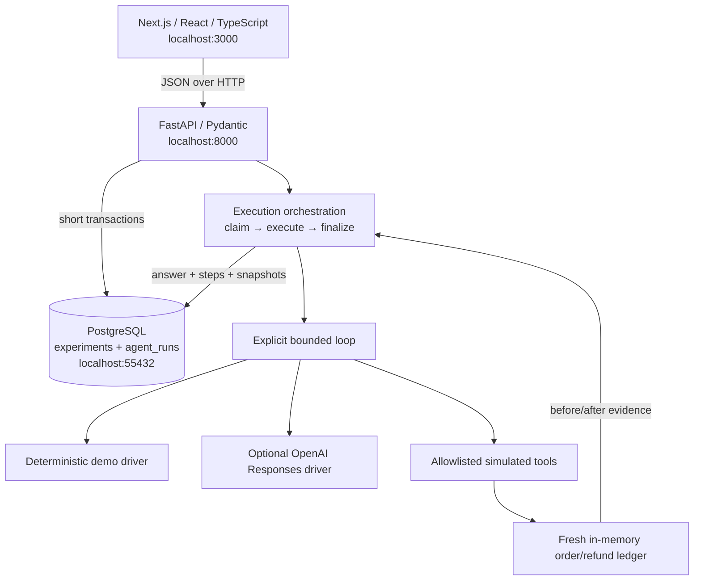

# Agent Autopsy: project rundown after the agent-runner milestone

## Purpose and scope

Agent Autopsy is a reliability testing platform for AI agents that take actions. Its central question is: **does the agent's report agree with the actions that executed and the resulting business state?** The long-term goal is to compare agent versions under reproducible normal, faulty, and adversarial conditions, using Arize Phoenix to investigate failures.

The first domain is order refunds. A future example is a refund that succeeds but whose response gets lost: does the agent incorrectly retry, misreport failure, or verify the actual state? That fault is not implemented yet. The current milestone establishes the normal execution and evidence path needed to test it properly.

This differs in focus from RAGLens (retrieval/answer observability) and QueueFlow (distributed job processing). Agent Autopsy centers on action correctness and recovery. Those projects provide related skills, but this implementation does not yet claim retrieval analysis or distributed worker execution. No market-wide uniqueness claim is implied.

## What we built, step by step

1. **Repository and architecture boundary.** Created the public `ChanakyaG2004/agent-autopsy` repository, documented the purpose, and separated frontend, backend, and design notes. The architecture worksheet records questions to learn through examples; it does not claim that the learner has already mastered them.
2. **Development scaffold.** Added Next.js/React/TypeScript, a Python FastAPI application, dependency lockfiles, Node/Python version selection, ignored local artifacts, and local setup instructions. One repository keeps contracts and UI/backend changes easy to review together.
3. **First page.** Added the product introduction and reusable typed `EvidenceItem`. The page explains the three evidence categories: claim, executed actions, actual state. This introduced App Router pages/layouts, JSX, typed props, and Server Components.
4. **Interactive configuration and validation.** Added a Client Component with controlled fields for name, agent-version label, and scenarios. Built loading/error/success behavior and a real API request. FastAPI/Pydantic reject blank names, invalid scenarios, duplicates, oversized fields, and unexpected fields. The original validation endpoint intentionally did not save anything.
5. **PostgreSQL persistence.** Added SQLAlchemy models, Alembic migrations, request-scoped sessions, transactional draft creation, UUID retrieval, bounded listing, and database failure handling. The UI now saves and reloads records. Added an isolated PostgreSQL bootstrap and integration tests against a dedicated test database. Confirmed drafts survive application/database restarts.
6. **This branch: executable refund agent.** Added the explicit six-turn tool loop, isolated order/refund sandbox, strict tool validation, deterministic demo driver, optional OpenAI adapter, persisted run history, atomic run admission, lifecycle statuses, and UI inspection of claims/actions/state. Verified an actual browser demo and reloaded its persisted result. Live OpenAI behavior remains unverified.

Branches are stacked checkpoints: `experiment-foundation` → `feature/first-page` → `feature/experiment-form` → `feature/experiment-persistence` → `feature/agent-runner`. The work has not been merged into `master` as part of this milestone. Use the latest feature branch to see the complete application.

## Current system design

The browser owns interaction and presentation. It cannot access PostgreSQL, model credentials, or arbitrary tools. FastAPI owns the request boundary and orchestration. The runner owns iterative decision/execution flow. Tools own controlled state mutations. PostgreSQL owns saved configurations and run evidence. There is no Next.js API proxy or hidden agent framework in the path.

The current normal run is synchronous: the browser waits while the API executes the loop. FastAPI's synchronous handler runs in a worker thread. This is easy to follow and test for one local experiment, but every concurrent execution occupies request capacity. Long benchmark batches should move to a queue and workers later.

## Data model and ownership

| Entity | Important fields | Purpose |
| --- | --- | --- |
| Experiment | UUID, name, agent_version, scenarios, status, created_at | Saved configuration and latest execution status |
| AgentRun | UUID, experiment_id foreign key, driver mode, model label, task, status, timestamps | One execution attempt |
| Run evidence | answer/error, JSONB steps, initial_state, final_state | Compare report, executed actions, and actual sandbox state |

An experiment can have many run records. UUIDs provide identities. The foreign key prevents orphan runs. Constraints enforce valid lifecycle/mode values. Indexes support experiment listing and finding a parent's runs. JSONB holds evolving evidence structures while relational columns preserve identity and lifecycle. Typed response models define the browser contract.

SQLAlchemy maps Python objects/queries to SQL and manages transactions. A session is a unit of database work, not a database itself. Alembic versions schema changes explicitly; starting the server does not silently create or rewrite tables. PostgreSQL gives durable storage, transactions, and concurrency control. Plain browser state would disappear on reload and could not arbitrate competing API requests.

There are no separate agents, benchmark_tasks, evaluations, or production orders/refunds tables yet. `agent_version` is currently a supported implementation label, not a foreign key to a version registry. Business state lives in a fresh sandbox during each run and is persisted as evidence snapshots afterward.

## Request flows

**Saving:** controlled React state → POST configuration → Pydantic validation → transactional INSERT → commit → typed 201 response → list refresh → later GET reads from PostgreSQL.

**Running:** explicit run click → POST experiment UUID and driver mode → validate saved version/scenario → conditional status claim and initial run INSERT → commit → ask driver → validate requested tool → mutate sandbox → return tool result to driver → final answer or failure → atomically persist outcome and terminal statuses → show evidence.

**Inspecting:** reload page → fetch experiments → open run panel → Refresh run history → retrieve persisted evidence. React state is a display cache; PostgreSQL is the source of saved history.

**Failure:** invalid input is rejected before work; unsupported configurations return a conflict; missing model settings do not claim a run; provider/tool failures stop execution and save partial evidence. A lost HTTP response is ambiguous because a server commit may already have succeeded. The UI asks the user to inspect saved history before repeating an action.

## Why these design choices matter

- **Explicit loop:** exposes decisions, arguments, outputs, and stopping behavior. A large framework would currently obscure the concepts we want to learn. Frameworks remain an option when graph/state coordination creates a real need.
- **Strict execution boundary:** model-produced arguments are untrusted inputs. Tool schemas guide a model, but server-side validation and business rules decide what may execute.
- **Integer cents:** avoids binary floating-point ambiguity for this monetary example. Currency is fixed to USD in the sandbox.
- **Short transactions:** never leave a database transaction open while waiting for a model request. A committed claim is visible to other requests, and the connection is not held in an active transaction during execution.
- **Atomic claim:** a conditional SQL UPDATE prevents simultaneous executions of the same experiment. It does not provide global admission control, durable job leases, or exactly-once distributed processing.
- **Evidence separation:** final text can be wrong even when the loop completes normally. Tool execution alone also does not establish intended task success. A state-based evaluator is needed.
- **Driver independence:** deterministic demo, optional model, and test doubles use the same loop/tools. This makes infrastructure testable without credentials or model charges, while avoiding claims that scripted success measures model quality.
- **Runtime browser validation:** TypeScript types disappear at runtime. Response guards check received JSON before displaying it as a typed record.

## Where Arize Phoenix fits next

Phoenix is central to the intended observability layer, but **not connected yet**. PostgreSQL currently contains saved business evidence, not Phoenix traces.

The intended next shape is one trace per run, with child spans for driver/model calls and tool executions. OpenTelemetry will carry trace context and span data; OpenInference will supply AI-specific conventions; Phoenix will let us inspect that telemetry. A future `trace_id` on the run should connect PostgreSQL evidence to the trace. Token/cost/latency fields must come from measured execution, never invented demo values.

We should keep application evidence independently durable. A later telemetry exporter failure should not silently redefine a business outcome. Export buffering, loss reporting, and failure handling must be designed and tested when tracing is implemented; those guarantees do not exist today.

## What was verified

At this checkpoint, the backend suite checks validation, real PostgreSQL persistence, migrations, run lifecycle, concurrency, tool boundaries, loop limits, partial failure state, and mocked OpenAI behavior. Frontend lint, TypeScript checking, and a production build pass. The browser successfully created a normal experiment, executed the demo, displayed one 4900-cent refund, and retrieved the same run after reloading.

These checks establish behavior of the implemented local slice. They do not establish model accuracy, benchmark success rate, production throughput, resilience under injected faults, security against prompt injection, or Phoenix integration.

## What remains and why

1. **Review and learning:** follow the execution walkthrough and write one deterministic evaluator yourself; review it together.
2. **Phoenix instrumentation:** make the existing control flow visible as a real trace, including deliberately failed runs.
3. **Faults and evaluations:** introduce timeout-after-commit and permission-denied behavior, then compare claims with actual ledger state. Record evaluation outcomes separately from execution completion.
4. **Reproducible comparisons:** version tasks, prompts, tools, code/model configuration; run a small benchmark across baseline and improved agent versions.
5. **Background execution:** add durable jobs, leases, cancellation, idempotency, retry policy, backpressure, and crash recovery when request-bound execution becomes a constraint.
6. **Deployment:** add authentication, secret management, containerization, CI, and operational checks. Kubernetes is a later learning/deployment choice, not a requirement for this local slice.

A full dashboard, clustering, retrieval, security scorecards, automatic fix proposals, and infrastructure scaling are later features. We have a working execution/evidence foundation, not the complete long-term platform.

## Interview explanation and understanding checks

You can accurately describe the implemented architecture as: “A Next.js/FastAPI prototype that runs a bounded refund agent against validated simulated tools, stores configuration and run evidence in PostgreSQL, and separates agent claims from actual state. It includes a deterministic driver and an optional model adapter; Phoenix tracing and evaluation are the next milestones.” Use that explanation after reviewing the code, without claiming unbuilt features or unmeasured improvements.

Try answering these from the code:

1. Why can an execution be completed while the task failed?
2. Which SQL operation prevents simultaneous runs of one experiment?
3. Why do we commit before calling the driver?
4. What survives a provider failure, and what might be lost in a process crash?
5. Why do strict function schemas still need runtime tool validation?
6. Why are demo results insufficient to claim LLM reliability?
7. What information should go to PostgreSQL versus a future Phoenix trace?

## Git date note

The repository's author/committer timestamps were explicitly selected at the user's request, one checkpoint at a time. They are Git metadata, not evidence of elapsed development time. GitHub creation, push, and activity timestamps can differ. Application/run timestamps record actual execution time and were not backdated.
